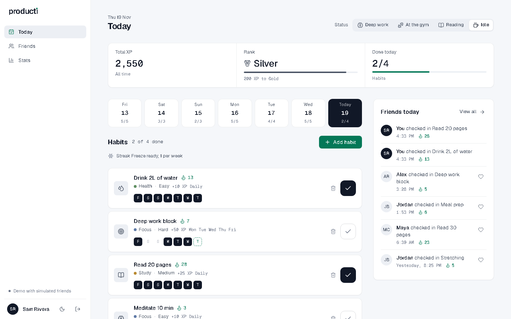
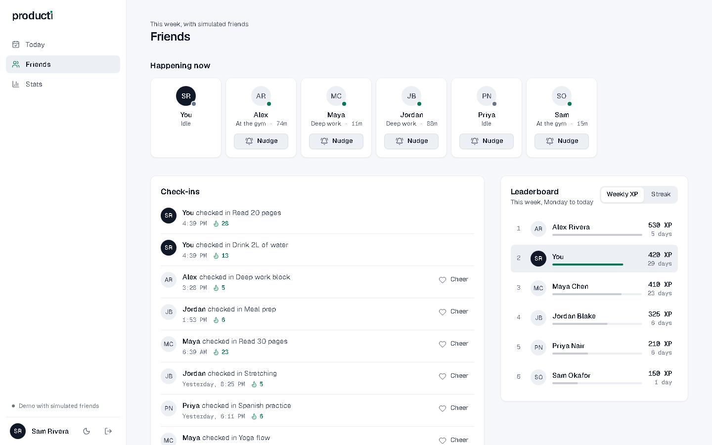

# Producti

**A daily log for your habits, with streaks, XP and friends who notice.**

[**Live demo → getproducti.vercel.app**](https://getproducti.vercel.app)



> This is a portfolio demo with no server. Your profile and habits are stored only in your browser, and the friends are simulated on your device.

## The app

**Today** is where you check in. It shows three headline figures (total XP, rank, done today), a 7-day strip to look back through the week, and each habit's last seven days drawn as a log. On wide screens, friends' latest check-ins sit alongside.


**Stats** has the weekly consistency chart and a per-habit table: current streak, best-ever streak, 30-day completion rate, check-ins and XP earned.



**Friends** shows who's active now, the full check-in feed and the weekly leaderboard, ranked by XP or by streak.

<p>
  
  &nbsp;
  
</p>

The sign-up screen asks for a full name, username and email, with an opt-in for notifications. On phones the sidebar becomes a bottom tab bar, and dark mode is a full palette of its own rather than an inverted one.

## What it does

- **Habits with real streak rules.** Streaks count scheduled days only, so a Mon/Wed/Fri habit is never broken by a Tuesday.
- **A weekly Streak Freeze.** One per week, spent automatically to protect a streak when you miss a day.
- **Fair XP, no difficulty picker.** Every check-in earns 10 XP plus 1 per streak day (up to +20), so XP only grows by showing up. Users can't pick a bigger reward.
- **Sign-up with validation.** Full name, username (suggested from your name) and email, with clear errors and focus on the first one to fix. A shortcut lets visitors explore with sample data instead.
- **Friends that react.** Cheer a friend and they thank you; nudge one and they check in. It's scripted, but nothing in it is a dead button.
- **Notifications.** Opt in at sign-up or from the sidebar to get a browser notification when a friend reacts while the app is in the background.
- **Stats per habit.** Best streak and 30-day completion, computed by the same rules as the live streak.
- **Installable and offline.** Add it to your home screen and it opens without a connection.
- **Light and dark mode**, keyboard accessible, and it works on phone and desktop.

## Design

- **Palette:** navy-tinted neutrals with one emerald accent. Emerald appears only where something is done or alive: the main action, streaks, today's progress and the selected chart bar.
- **Type:** Geist for the interface, and Geist Mono for every number so figures line up.
- **Logo:** a "producti" wordmark whose i-dot is an emerald tile. The same tile, with a check, is the favicon and the app icon.

## How it's built

| | |
| --- | --- |
| Stack | React 19, TypeScript, Vite, Tailwind CSS v4, Lucide icons |
| State | One pure reducer; every change is a tested, deterministic function |
| Storage | `localStorage` with a versioned schema and step-by-step migrations, so saved data is never wiped |
| Dates | Plain calendar days (`2026-11-19`), never timestamps, so streaks survive midnight and timezone changes |
| Routing | Hash routes (`#/`, `#/friends`, `#/stats`), so it runs as plain static files |
| Tests | 55 unit tests with Vitest, covering streaks, freezes, stats, XP, sign-up validation, migrations and security |
| Hosting | Vercel, with a strict Content-Security-Policy and security headers |

### Security

I attacked the app myself and fixed what got through:

- **Saved data is untrusted.** Everything loaded from storage is validated and repaired, so tampered data can't crash the app, freeze it or corrupt the numbers ([src/lib/validate.ts](src/lib/validate.ts)).
- **Security headers.** A strict CSP, no framing (clickjacking), `nosniff`, a referrer policy and a permissions policy ([vercel.json](vercel.json)).
- **A recovery screen.** If anything still fails, an error boundary offers a reset that keeps a backup.
- **Regression tests.** Each attack is a test ([src/lib/security.test.ts](src/lib/security.test.ts)).

## Run it locally

```bash
npm install
npm run dev      # http://localhost:5173
```

| Command | What it does |
| --- | --- |
| `npm run dev` | Start the dev server |
| `npm test` | Run the unit tests |
| `npm run lint` | Lint with oxlint |
| `npm run build` | Type-check and build for production |

### Privacy policy

The privacy policy and terms are at real URLs, ready for app store listings:

- https://getproducti.vercel.app/privacy
- https://getproducti.vercel.app/terms

### Demo tools

Press **Alt + Shift + T** for a hidden dev panel. It can:
- jump the date forward to show streaks growing or breaking and rank-ups;
- make friends reply in seconds;
- reset the sample data.

## Code layout

```
src/
  types.ts            Data model
  lib/
    dates.ts          Calendar-day helpers
    streaks.ts        Streak + Streak Freeze rules (written out at the top)
    game.ts           XP, ranks, daily and weekly totals
    social.ts         Deterministic friend simulation
    reducer.ts        Every state change, as a pure reducer
    storage.ts        The only module that touches localStorage
    validate.ts       Validates and repairs saved data
  components/
    Sidebar.tsx       App shell: sidebar on desktop, top bar + tab bar on phones
    Overview.tsx      Page header, status control and the headline figures
    HabitStats.tsx    Per-habit stats table
    Logo.tsx          The wordmark and app-icon tile
    …                 HabitCard, FriendFeed, Leaderboard, AddHabitModal, WeeklyChart
public/sw.js          Service worker for offline use
```

To change the data model, bump `SCHEMA_VERSION` in `src/lib/storage.ts` and add a migration.
