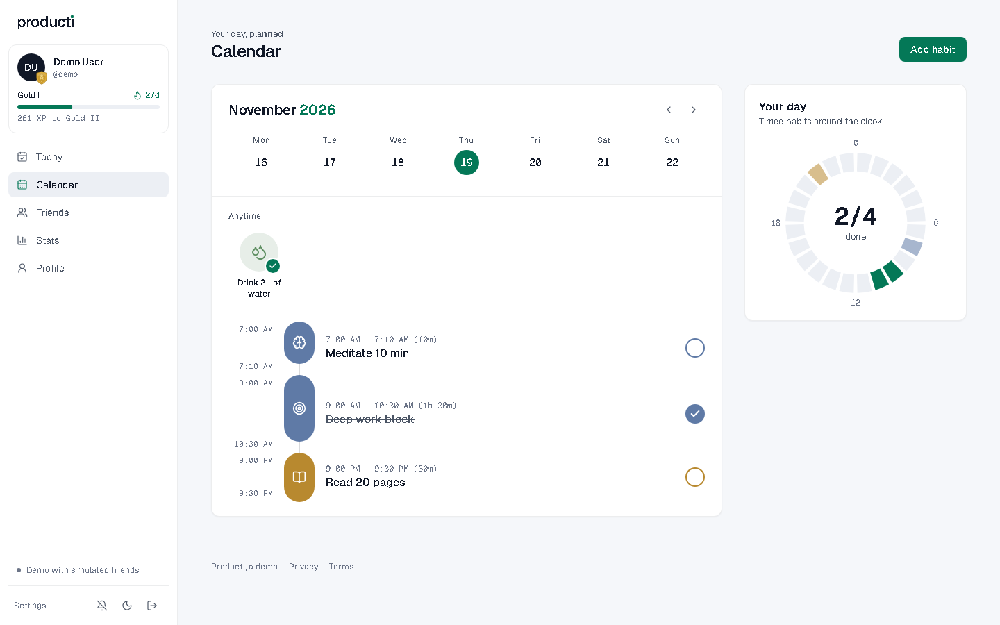
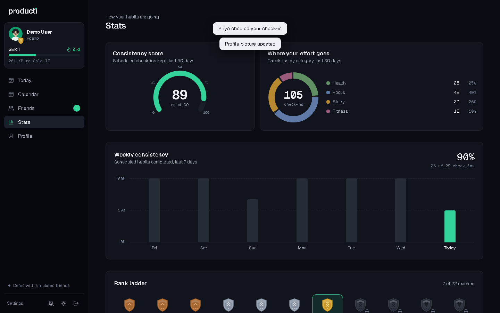
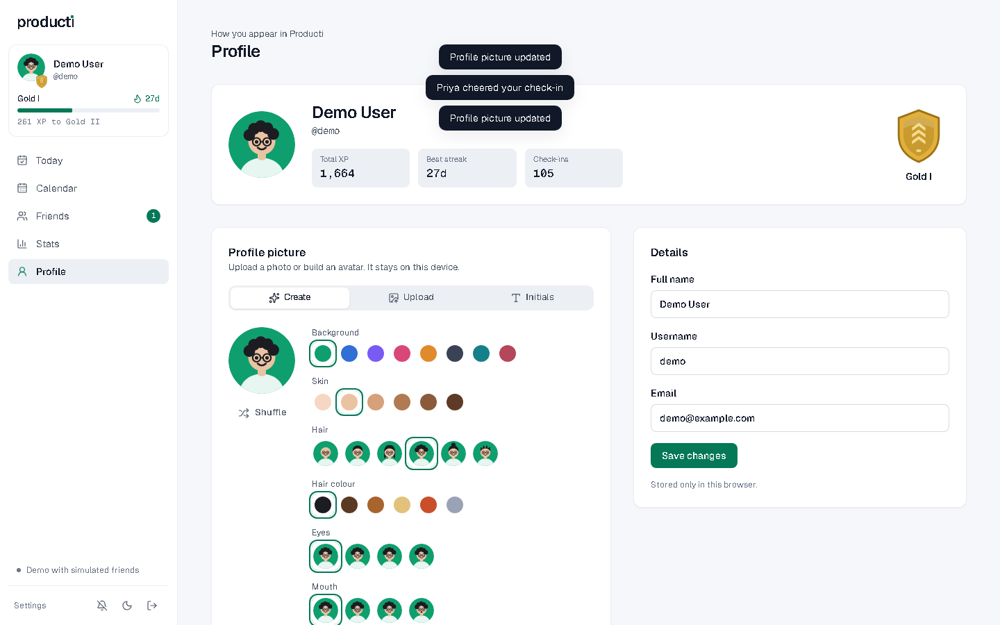
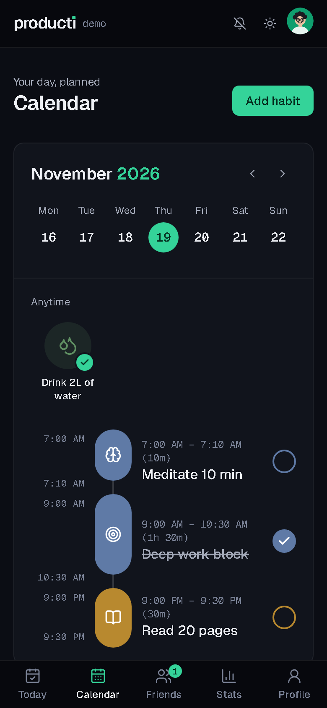
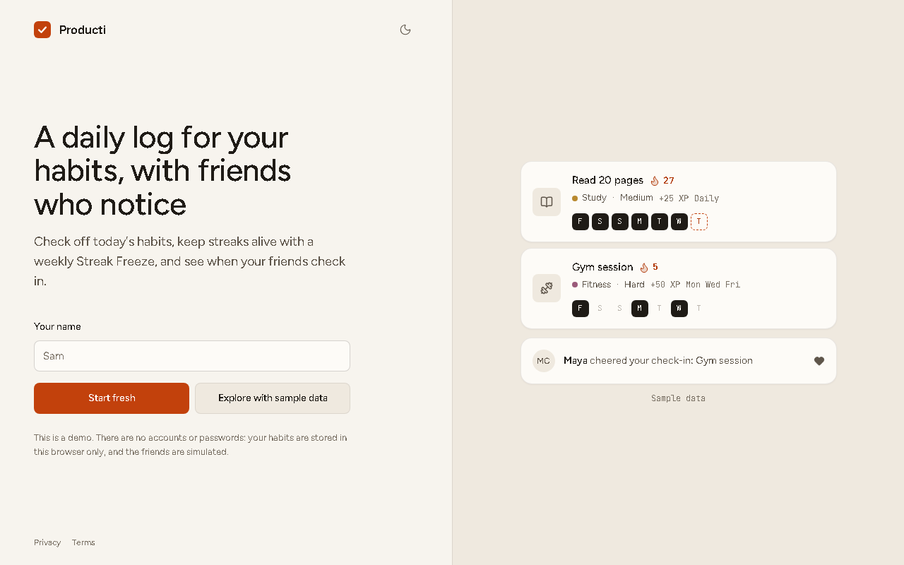

# Producti

**A daily log for your habits, with streaks, XP and friends who notice.**

[**Live demo → getproducti.vercel.app**](https://getproducti.vercel.app)


> This is a portfolio demo with no server. Your profile and habits are stored only in your browser, and the friends are simulated on your device.

## The app

**Today** is your dashboard: your rank emblem and progress to the next rank, a gauge for today's score, XP over the last seven days, then your habits with their streaks. Friends' latest check-ins sit alongside on wide screens.



**Calendar** plans your day. Habits with a time appear on a timeline with their start, end and length; the rest sit at the top as "Anytime" chips. A 24-hour ring shows how the day is filled. Today's habits can be ticked off right there.



**Stats** has a 30-day consistency score, where your effort goes by category, the weekly chart, the full rank ladder and a per-habit table (streak, best streak, 30-day completion, check-ins and XP).


**Friends** shows who's active now, the check-in feed and a weekly leaderboard with a podium for the top three.



**Profile** lets you edit your name, username and email, and pick a picture: build an avatar (background, skin, hair, eyes, mouth, glasses), upload a photo, or use initials.

<p>
  
  &nbsp;
  
</p>

On phones the sidebar becomes a bottom tab bar, and dark mode is a full palette of its own rather than an inverted one.

## Ranks

A competitive ladder of 22 ranks, each with its own emblem:

> Bronze I–III · Silver I–III · Gold I–III · Platinum I–III · Diamond I–III · Champion I–III · Overlord I–III · **Eternal**

Each step takes a little more XP than the last (step *i* starts at 25·i² + 100·i XP), so Silver arrives in days and Eternal takes months of showing up.

## What it does

- **Habits with real streak rules.** Streaks count scheduled days only, so a Mon/Wed/Fri habit is never broken by a Tuesday.
- **A weekly Streak Freeze.** One per week, spent automatically to protect a streak when you miss a day.
- **Fair XP, no difficulty picker.** Every check-in earns 10 XP plus 1 per streak day (up to +20), so XP only grows by showing up. Users can't pick a bigger reward.
- **Sign-up with validation.** Full name, username (suggested from your name) and email, with clear errors and focus on the first one to fix. A shortcut lets visitors explore with sample data instead.
- **Friends that react.** Cheer a friend and they thank you; nudge one and they check in. It's scripted, but nothing in it is a dead button.
- **Notifications.** Opt in at sign-up or from the sidebar to get a browser notification when a friend reacts while the app is in the background.
- **A 22-step rank ladder** from Bronze I to Eternal, with an emblem per tier and a rank-up message when you climb.
- **A day planner.** Optional start times and lengths put habits on a calendar timeline.
- **Profile and avatars.** Build a cartoon avatar or upload a photo (cropped and shrunk on the device; only JPG, PNG and WebP are accepted).
- **Charts that reward showing up.** Today's score gauge, 7-day XP bars, a consistency gauge, effort by category, a podium leaderboard and per-habit stats.
- **Installable and offline.** Add it to your home screen and it opens without a connection.
- **Light and dark mode**, keyboard accessible, and it works on phone and desktop.

## Design

- **Palette:** navy-tinted neutrals with one emerald accent. Emerald appears only where something is done or alive: the main action, streaks, today's progress and the selected chart bar.
- **Type:** Geist for the interface, and Geist Mono for every number so figures line up.
- **Gamified moments:** rank emblems are the one place rich colour appears, each tier with its own hue. Gauges, a donut and the 24-hour ring follow the same palette.
- **Logo:** a "producti" wordmark whose i-dot is an emerald tile. The same tile, with a check, is the favicon and the app icon.

## How it's built

| | |
| --- | --- |
| Stack | React 19, TypeScript, Vite, Tailwind CSS v4, Lucide icons |
| State | One pure reducer; every change is a tested, deterministic function |
| Storage | `localStorage` with a versioned schema and step-by-step migrations, so saved data is never wiped |
| Dates | Plain calendar days (`2026-11-19`), never timestamps, so streaks survive midnight and timezone changes |
| Routing | Hash routes (`#/`, `#/calendar`, `#/friends`, `#/stats`, `#/profile`), plus real paths for `/privacy` and `/terms` |
| Tests | 61 unit tests with Vitest, covering streaks, freezes, XP, ranks, stats, sign-up and avatar validation, migrations and security |
| Hosting | Vercel, with a strict Content-Security-Policy and security headers |

### Security

I attacked the app myself and fixed what got through:

- **Saved data is untrusted.** Everything loaded from storage is validated and repaired, so tampered data can't crash the app, freeze it or corrupt the numbers ([src/lib/validate.ts](src/lib/validate.ts)).
- **Security headers.** A strict CSP, no framing (clickjacking), `nosniff`, a referrer policy and a permissions policy ([vercel.json](vercel.json)).
- **A recovery screen.** If anything still fails, an error boundary offers a reset that keeps a backup.
- **Regression tests.** Each attack is a test ([src/lib/security.test.ts](src/lib/security.test.ts)).

## Run it locally

```bash
npm install
npm run dev      # http://localhost:5173
```

| Command | What it does |
| --- | --- |
| `npm run dev` | Start the dev server |
| `npm test` | Run the unit tests |
| `npm run lint` | Lint with oxlint |
| `npm run build` | Type-check and build for production |

### Privacy policy

The privacy policy and terms are at real URLs, ready for app store listings:

- https://getproducti.vercel.app/privacy
- https://getproducti.vercel.app/terms

### Demo tools

Press **Alt + Shift + T** for a hidden dev panel. It can:
- jump the date forward to show streaks growing or breaking and rank-ups;
- make friends reply in seconds;
- reset the sample data.

## Code layout

```
src/
  types.ts            Data model
  lib/
    dates.ts          Calendar-day helpers
    streaks.ts        Streak + Streak Freeze rules (written out at the top)
    game.ts           XP, ranks, daily and weekly totals
    social.ts         Deterministic friend simulation
    reducer.ts        Every state change, as a pure reducer
    storage.ts        The only module that touches localStorage
    validate.ts       Validates and repairs saved data
  components/
    Sidebar.tsx       App shell: sidebar on desktop, top bar + tab bar on phones
    Overview.tsx      Page header, status control and the headline figures
    HabitStats.tsx    Per-habit stats table
    Logo.tsx          The wordmark and app-icon tile
    …                 HabitCard, FriendFeed, Leaderboard, AddHabitModal, WeeklyChart
public/sw.js          Service worker for offline use
```

To change the data model, bump `SCHEMA_VERSION` in `src/lib/storage.ts` and add a migration.
